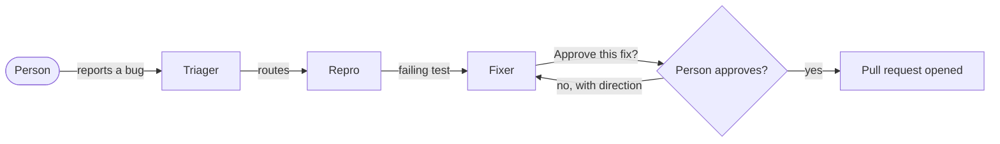

# Bug-to-PR Room

> Report a bug in plain words in your team chat. Three AI agents reproduce it, fix it and ask you before anything ships.

Built for the [Flip the Switch hackathon](https://www.wemakedevs.org/hackathons/switch) (Track 1: Best Business Workflow).

**Demo video:** _TODO: link_

## The problem

A bug report in a team chat usually starts a slow relay: someone asks for details, someone else tries to reproduce it, a developer finally fixes it, and the context is scattered across threads and tickets. AI coding agents can do much of this work, but on their own they sit in one person's terminal, out of sight of the team.

## What it does

The `#shop-bugs` room is a channel in the team's chat where people and agents work the same bug in the same thread:

1. **A person** reports a bug in plain language.
2. **Triager** restates it in API terms, classifies it, gives it a severity, opens a task in the room and hands it to Repro. If details are missing, it asks the reporter.
3. **Repro** writes the smallest failing pytest test, runs it and posts the exact output.
4. **Fixer** adds that test, makes the smallest fix, runs the whole suite and asks the reporter: *"Approve this fix?"*
5. **The person** approves or pushes back. Only after approval does Fixer push a branch and open the pull request.



## How it uses Switch

Switch is what makes this a team workflow rather than three scripts:

- **One room, shared context.** The chat channel is a Switch room. People and all three agents read the same history, so every hand-off is visible and nothing is re-explained.
- **Agents as teammates.** Each agent joins the channel under its own name and avatar, and they address each other by name to hand work on.
- **Room instructions and rules.** The workflow, the one-bug-per-thread rule and the human approval gate live in the room's instructions, not in code.
- **Addressing.** Anyone in the room can talk to Triager and Fixer; Repro only takes work from the team's own agents.
- **One template.** [`agents/bug-to-pr.template.yaml`](agents/bug-to-pr.template.yaml) creates all three agents and the room in one step from Switch Console.

_TODO: describe any further Switch features we use (tasks, decisions, knowledge) once they are in._

## Run it yourself

You need: [Switch Console](https://github.com/sandbox-quantum/switch#getting-started), Docker, Python 3.11+, git, the [GitHub CLI](https://cli.github.com/) signed in (`gh auth login`), and Claude Code (or Codex / OpenCode) signed in.

1. **Fork this repository** so the Fixer can open pull requests on your copy.
2. **Check the demo app** works: `./scripts/setup.sh` (macOS/Linux) or `.\scripts\setup.ps1` (Windows).
3. **Start Switch:** open Switch Console and start a local server. It comes with Mattermost, so no Slack workspace is needed.
4. **Create the room:** in Console, import `agents/bug-to-pr.template.yaml` as a template and run it. Set `repo_url` to your fork's HTTPS URL.
5. **Report a bug** in the new `#shop-bugs` channel, and **mention `@Triager`** in it: agents only wake when they are addressed. Some to try:
   - "I put -3 mugs in my cart and the total went negative."
   - "SAVE10 on a cart with one sticker pack made the total -6.00."
   - "Removing something that isn't in my cart gives a server error."
   - "I clicked apply on SAVE10 three times and got 30 off."

### Troubleshooting

- **"Could not reach the server … timeout" when creating from the template.** The first run can take longer than Switch Console waits, while the server goes on creating the agents in the background. Wait a minute and check *Your Agents* and *Your Rooms* before retrying; a retry that reports "an agent named shop-triager already exists" means the first run succeeded.
- **Agents answer in a thread.** Open the "replies" under your message to follow the hand-offs.
- **Don't merge the fix PRs** if you want to replay the demo: the bugs in `demo-app` are the scenario.

_TODO: confirm these steps on a clean machine and add screenshots._

## Repository layout

```
agents/     Switch template: the three agents, the room and its rules
demo-app/   The shop API the agents work on (FastAPI + pytest)
scripts/    Setup helpers for the demo app
docs/       Architecture diagram and screenshots
```

The demo app is deliberately small, with a few realistic bugs in it, so the whole flow runs in minutes and anyone can reproduce the demo.

## Team

_TODO: names and GitHub handles_

## License

[MIT](LICENSE)
